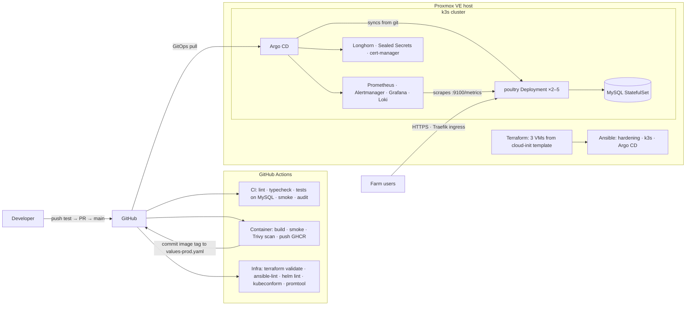

# Site reliability: platform, SLOs and operations

How Poultry Farm Manager is built, shipped, run and watched on a home-lab Kubernetes cluster that
is created entirely from code.

## Architecture



| Layer | Tooling | Where |
| --- | --- | --- |
| Virtualization | Proxmox VE, cloud-init template | [`infra/terraform/proxmox`](../infra/terraform/proxmox) |
| Configuration | Ansible (hardening, k3s, Argo CD bootstrap) | [`infra/ansible`](../infra/ansible) |
| Packaging | Multi-stage Docker image, non-root, read-only root FS | [`Dockerfile`](../Dockerfile) |
| Deployment | Helm chart, Argo CD app-of-apps (GitOps) | [`infra/helm/poultry`](../infra/helm/poultry), [`infra/argocd`](../infra/argocd) |
| Observability | Prometheus metrics endpoint, kube-prometheus-stack, Loki, Grafana SLO dashboard | [`src/server/metrics.ts`](../src/server/metrics.ts), [`infra/helm/poultry/files`](../infra/helm/poultry/files) |
| Delivery | GitHub Actions: CI, Container, Infra, Deploy | [`.github/workflows`](../.github/workflows) |

## Service level objectives

Measured on API requests (`/api/*`) over a rolling 30 days.

| SLI | SLO | Error budget |
| --- | --- | --- |
| Availability: requests that do not fail with 5xx | 99.5% | 0.5% ≈ 3.6 hours of full outage a month |
| Latency: requests that finish within 500 ms | 95% | 5% of requests may be slower |

**Alerting** uses multi-window burn rates (Google SRE workbook), so pages mean real user impact:

| Alert | Condition | Severity | Runbook |
| --- | --- | --- | --- |
| `PfmErrorBudgetFastBurn` | 14.4× burn over 5 m and 1 h (budget gone in ~2 days) | page | [high-error-rate](runbooks/high-error-rate.md) |
| `PfmErrorBudgetSlowBurn` | 6× burn over 1 h and 6 h | ticket | [high-error-rate](runbooks/high-error-rate.md) |
| `PfmLatencySloBreach` | < 95% under 500 ms for 1 h | ticket | [slow-responses](runbooks/slow-responses.md) |
| `PfmNotReady` | database unreachable or schema mismatch for 3 m | page | [app-not-ready](runbooks/app-not-ready.md) |

**Error budget policy**

- Budget above 50%: ship normally.
- Budget 25–50%: releases need a rollback plan written in the PR.
- Budget below 25%: only reliability fixes ship until the budget recovers; hold a review of the top causes.
- Any page: write a [postmortem](postmortem-template.md) within 5 working days (blameless).

## Reliability built into the app and chart

- **Probes:** `/healthz` (process alive) for liveness, `/readyz` (database reachable, schema current)
  for readiness, so a database problem removes pods from traffic without restart loops.
- **Zero-downtime rollouts:** `maxUnavailable: 0`, a PodDisruptionBudget, and spread across nodes.
- **Autoscaling:** HPA from 2 to 5 replicas at 70% CPU. Data changes and migrations use MySQL named
  locks, so replicas never race each other.
- **Clean shutdown:** `tini` forwards SIGTERM; the server stops accepting work and closes the pool.
- **Least privilege:** non-root, read-only root filesystem, all capabilities dropped, no service
  account token, NetworkPolicies so only the app reaches MySQL.
- **Backups:** encrypted app backups to a ReadWriteMany Longhorn volume, a weekly automatic restore
  test (see [RECOVERY.md](RECOVERY.md)), and Longhorn volume replication across VMs.
- **Supply chain:** Trivy blocks images with fixable high/critical vulnerabilities; `npm audit`
  blocks vulnerable production packages; images are tagged by commit for traceability.

## Build the lab from zero

1. **Template** on Proxmox (once):
   ```bash
   wget https://cloud-images.ubuntu.com/noble/current/noble-server-cloudimg-amd64.img
   qm create 9000 --name ubuntu-2404-tmpl --memory 2048 --net0 virtio,bridge=vmbr0 --agent enabled=1
   qm importdisk 9000 noble-server-cloudimg-amd64.img local-lvm
   qm set 9000 --scsihw virtio-scsi-single --scsi0 local-lvm:vm-9000-disk-0 --ide2 local-lvm:cloudinit --boot order=scsi0 --serial0 socket --vga serial0
   qm template 9000
   ```
2. **VMs:** create an API token for a `terraform@pve` user, then:
   ```bash
   cd infra/terraform/proxmox && cp terraform.tfvars.example terraform.tfvars   # edit
   export PROXMOX_VE_ENDPOINT=https://pve.lan:8006/ PROXMOX_VE_API_TOKEN='terraform@pve!k3s=...'
   terraform init && terraform apply        # also writes infra/ansible/inventory/hosts.ini
   ```
3. **Cluster and GitOps:** replace `OWNER` in `infra/argocd/*.yaml` and the image repository in
   `infra/helm/poultry/values*.yaml`, push, then:
   ```bash
   cd infra/ansible && ansible-galaxy collection install -r requirements.yml
   K3S_TOKEN=$(openssl rand -hex 32) ansible-playbook -i inventory/hosts.ini site.yml
   export KUBECONFIG=$PWD/kubeconfig && kubectl get nodes
   ```
4. **The app's secret** (encrypted, safe to commit):
   ```bash
   kubectl create secret generic poultry-secrets -n poultry --dry-run=client -o yaml \
     --from-literal=DB_PASSWORD="$(openssl rand -hex 16)" \
     --from-literal=MYSQL_ROOT_PASSWORD="$(openssl rand -hex 16)" \
     --from-literal=SETUP_KEY="$(openssl rand -hex 16)" \
     --from-literal=BACKUP_ENCRYPTION_KEY="$(openssl rand -hex 32)" \
     | kubeseal --format yaml > infra/helm/poultry/templates/sealed-secret.yaml
   ```
   Keep a copy of `BACKUP_ENCRYPTION_KEY` outside the cluster: backups cannot be read without it.
5. **Ship:** merge to `main`. CI builds and scans the image, commits the new tag, and Argo CD rolls
   it out. Open Grafana → *Poultry Farm Manager — SLOs*.

## Run it locally

```bash
docker compose up --build
```

App on http://localhost:3000, Prometheus on :9090 (alert rules loaded), Grafana on :3001 with the
SLO dashboard.

## Chaos drills (practice before real incidents)

| Drill | Command | Expected |
| --- | --- | --- |
| Kill a pod | `kubectl delete pod -n poultry -l app.kubernetes.io/component=web --wait=false` | No failed requests; HPA/Deployment replaces it |
| Lose a worker VM | Stop `k3s-agent-1` in Proxmox | Pods reschedule; Longhorn keeps volumes available |
| Database outage | `kubectl scale sts poultry-mysql -n poultry --replicas=0` | `PfmNotReady` fires; pods go unready but stay alive; recovery is automatic after scaling back |
| Bad release | Deploy an image tag that does not exist | Rollout stalls on readiness, old pods keep serving; revert the tag commit |
